# Introdução
Projeto FoodExpress, utilizado para teste de caixa cinza com as ferramentas Supabase, Postman, Selenium IDE e GitHub.


## Objetivo da Atividade
A atividade realizada tem como proposta aplicar testes de caixa cinza em uma API de autenticação. Foi utilizado como exemplo o projeto FoodExpress, utilizando as ferramentas:
- Supabase | Armazena as credenciais utilizadas para o login válido
- Postman | Ambiente de testes HTTP para login válido e inválido
- Selenium IDE | Ferramenta para gravar os testes no projeto real
- GitHub | Repositório do projeto alterado para integrar os dados do Supabase


## Configuração do Supabase
Foi criado um projeto no Supabase para armazenar as credenciais válidas que serão utilizadas para teste posteriormente. <br>

Na aba "Authentication", em "Sign In / Providers" foi ativado as opções de confirmação de e-mail e o uso de e-mail para criar usuários, com isso foi possível criar um usuário utilizando e-mail (existente@gmail.com) e senha (123456).

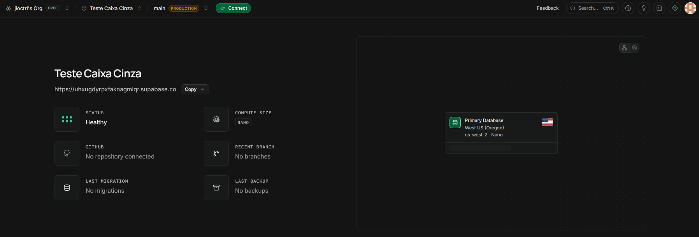
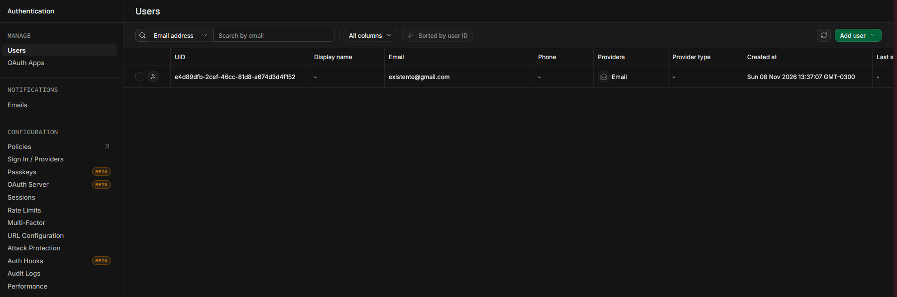


## Configuração do Postman
Dentro do Postman Desktop foi criado um Workspace público em branco. <br>

Dentro do Workspace "Teste Supabase", foram criados variáveis de teste dentro do menu "Environments": base_url, api_key, email, senha e access_token. Os valores de api_key e access_token são os mesmos, retirado do projeto no Supabase junto do base_url. Já o e-mail e senha são os mesmos do usuário criado dentro do projeto no Supabase, as credenciais válidas. <br>

Em "Collections" foi criado uma área de testes, com os dois testes que serão feitos: Login válido e Login inválido. Os dois testes são em forma de POST, no código json são enviados os dados de email e senha (password), no teste de Login válido esses dados são os mesmos colocados no Enviroment, enquanto no teste de Login inválido foi colocado um exemplo  de e-mail (email@facens.br) e senha (senhafalsa). <br>

Na área de teste, em script, foi feito um código para fazer 4 testes: credenciais corretas (status 200), validação das credencias pelo access_token, mensagem de erro (status 400) e erro do access_token. <br>

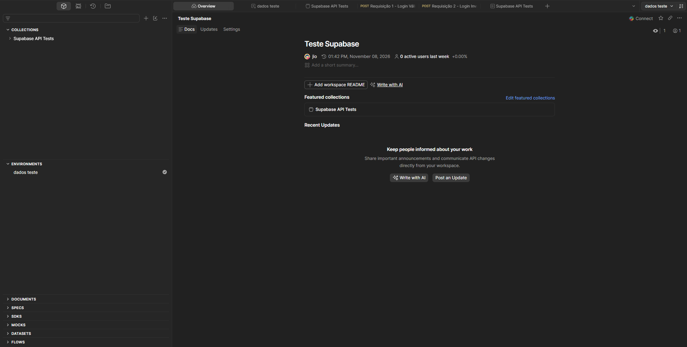
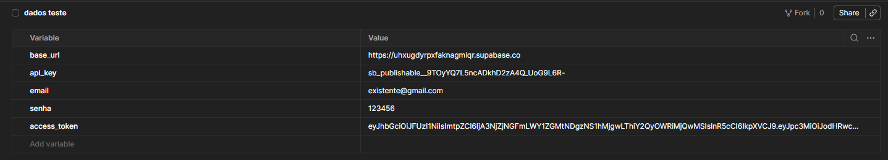


## Configuração das Requisições
O endpoint utilizado é `{{base_url}}/auth/v1/token?grant_type=password`, o base_url é puxado das variáveis, utilizando o URL do projeto no Supabase, enquanto o grant_type=password verifica se as credenciais correspondem a um usuário cadastrado. Ele é feito através do método POST, que envia as informações. <br>

Na aba headers foram utilizado o seguinte:
| Key | Valor |
| --- | ----- |
| apikey | `{{api_key}}` |
| Content-Type | application/json |

No Body JSON do Login inválido, foi preenchido da seguinta forma:
```JSON
{
  "email": "usuario@email.com",
  "password": "123456"
}
```

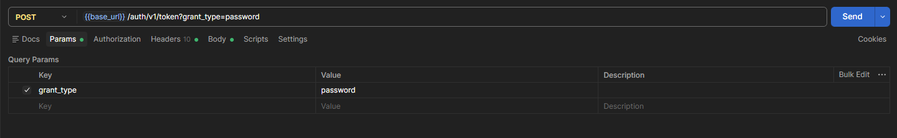
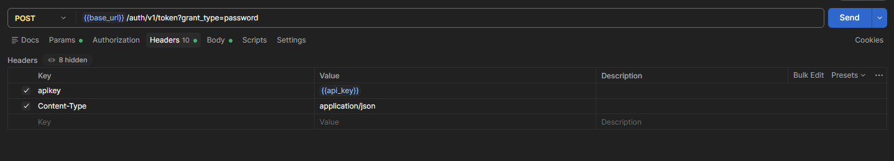
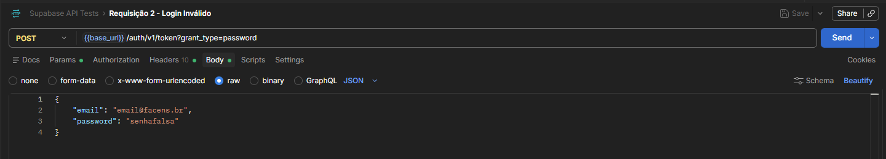
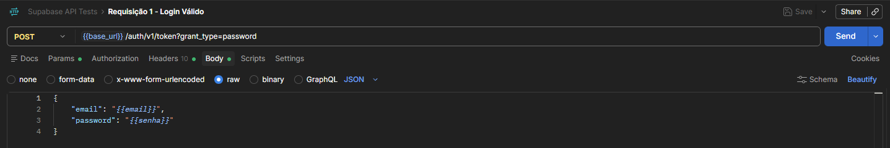
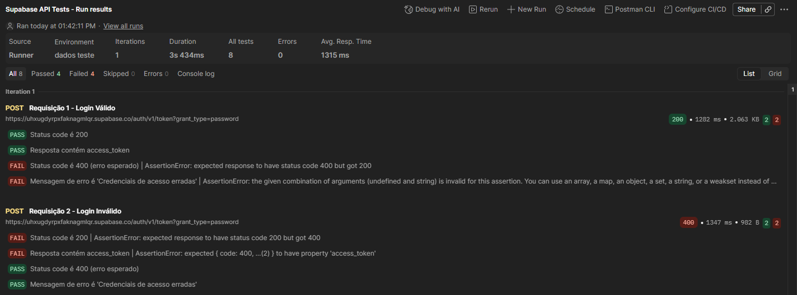


## Execução dos Testes
Os cenários utilizados, como já dito anteriormente, foram os de Login válido e Login inválido. <br>

No caso do Login válido, entre os 4 testes realizados pelo Postman, dois deles voltam como 'sucesso': status 200 e validação do access_token; Enquanto os testes realizados com o Login inválido retornam dois como 'sucesso': status 400 e mensagem 'Credenciais de acesso erradas'. Os dois possuem valores invertidos nos resultados dos testes, já que 2 deles são para credenciais válidas e os outros 2 para credenciais inválidas.

| Cenário | Entrada Utilizada | Resultado Esperado | Resultado Obtido | Status |
| ------- | ----------------- | ------------------ | ---------------- | ------ |
| Login válido | Usuário correto | Status 200 | Sucesso | OK |
| Login inválido | Usuário incorreto | Status 400 | Falhou | Erro |

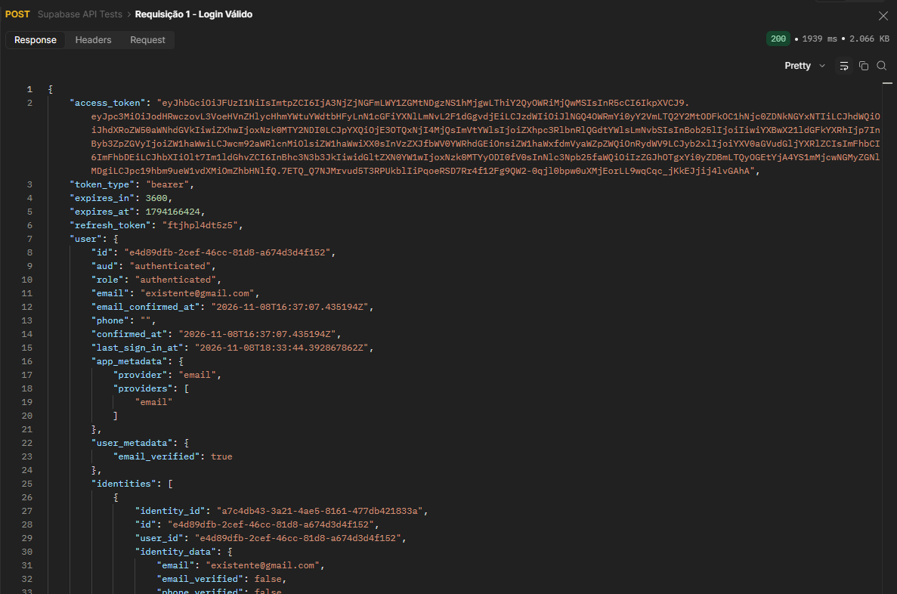
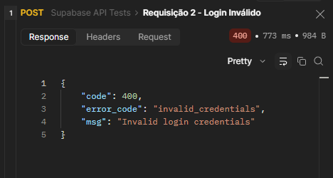


## Registro dos Testes
Os testes foram registrados através do Selenium IDE, gravando os dois testes de Login válido/inválido. <br>

O registro de testes de caixa cinza é importante para identificar falhas, registrando os procedimentos executados, os resultados obtidos, possibilitando a correção dessas falhas. Serve também como evidência de que o sistema foi verificado, contribuindo para a qualidade e a confiabilidade do sistema.

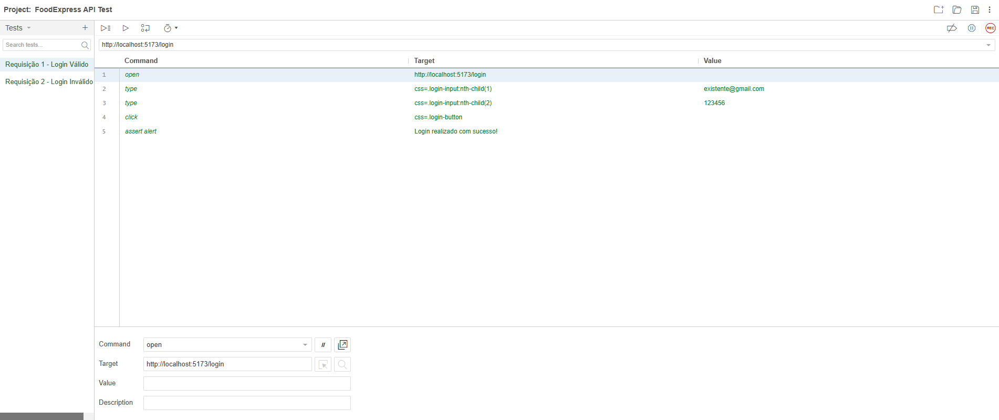
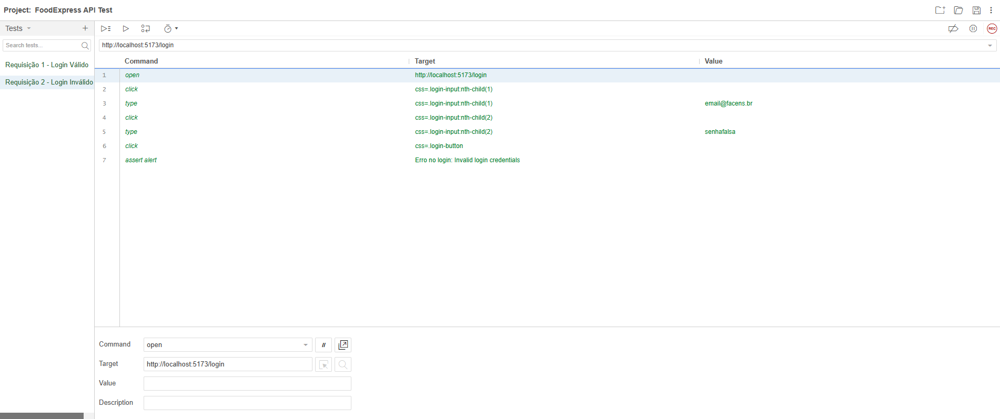


## Conclusão
A atividade realizada permitiu aplicar na prática os conceitos de teste de caixa cinza, utilizando o projeto FoodExpress como base para verificar o funcionamento da API de autenticação integrada ao Supabase. Com o auxílio das ferramentas Postman e Selenium IDE, foi possível executar e registrar cenários de login válido e inválido, verificando as respostas da API e o comportamento esperado para cada situação. <br>

Os testes demonstraram a importância de validar tanto o acesso com credenciais corretas quanto a rejeição de credenciais incorretas, além de verificar os códigos de resposta e os tokens de autenticação. O registro dos testes também se mostrou essencial para documentar os procedimentos realizados e os resultados obtidos, facilitando a identificação de possíveis falhas e futuras correções. <br>

Dessa forma, a atividade contribuiu para a compreensão da importância dos testes de software no desenvolvimento de sistemas, mostrando como a integração entre diferentes ferramentas auxilia na verificação, documentação e garantia da qualidade e confiabilidade de uma aplicação.